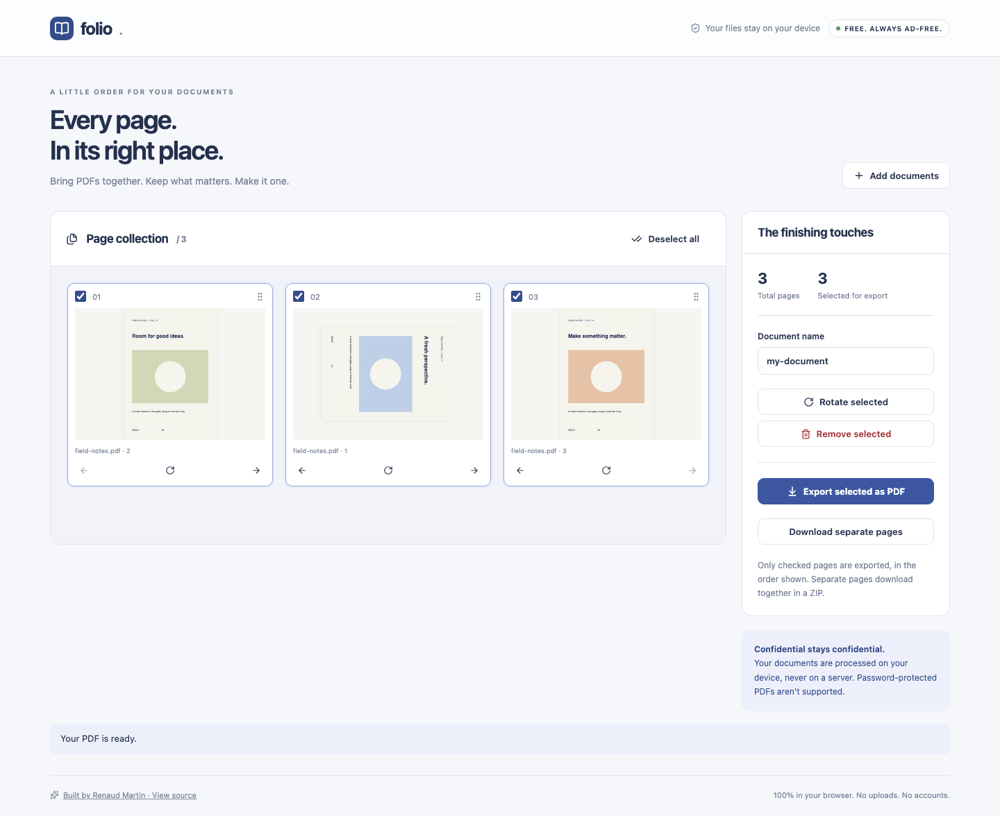

# Folio

Arrange, combine and export PDFs without uploading them.

[Live app](https://rjamartin.github.io/pdf-workbench/) · [Design & engineering case study](docs/CASE_STUDY.md)



## Features

- Import multiple PDFs, JPEGs and PNGs
- Real page thumbnails
- Drag to reorder, with keyboard-accessible arrow buttons
- Select, rotate and remove pages
- Export a merged PDF or one PDF per page in a ZIP
- Sample document and descriptive import/export errors

## Run locally

Node.js 22.12 or newer is required.

```sh
npm ci
npm run dev
```

```sh
npm test
npm run build
npm run preview
```

`npm run format` formats source and documentation. No API keys, database, backend or environment variables are needed.

## Deployment

This repository has a **Deploy to GitHub Pages** workflow. In repository **Settings → Pages**, select **GitHub Actions** as the source. In **Actions → Deploy to GitHub Pages**, choose **Run workflow** on `main`. The action installs the locked dependencies, tests and builds the app, then publishes `dist/`.

Publishing is manual so pushing work in progress does not immediately change the live portfolio. The relative Vite base supports both `/pdf-workbench/` and a custom-domain root. A separate CI workflow runs tests and a production build on pushes and pull requests.

## Architecture

- `src/App.tsx`: application state and interactive UI
- `src/pdf.ts`: processing and export logic
- `src/ui.tsx`: UI helpers and downloads
- `src/styles.css`: responsive visual system
- `src/*.test.ts`: focused behavior tests

TypeScript handles browser APIs and file-processing boundaries. React handles the interactive workspace; Vite emits ordinary static files suitable for GitHub Pages.

## Privacy

All processing runs on the visitor's device. File contents are never uploaded. There are no analytics or third-party runtime requests. Hosting still receives ordinary page and asset requests.

## Limits

- Up to 100 pages per workspace and 30 MB per file.
- Encrypted/password-protected PDFs are rejected.
- This is a page organizer, not a PDF text editor. Digital signatures, interactive forms, bookmarks and document-level metadata are not guaranteed to survive page assembly.
- Large or complex documents can use substantial device memory. Files are not persisted after closing the tab.

## Verification

Tests verify page order, merge dimensions, inherited plus user rotation, and empty-export rejection. Browser verification checks thumbnails, reorder, rotate and downloadable PDFs.

## Third-party software

React and React DOM (MIT); Vite (MIT); TypeScript (Apache-2.0); Lucide (ISC); pdf-lib (MIT); PDF.js (Apache-2.0); JSZip (MIT). Dependency license notices remain with their packages and distribution output.

Built by [Renaud Martin](https://github.com/RJAMartin).
